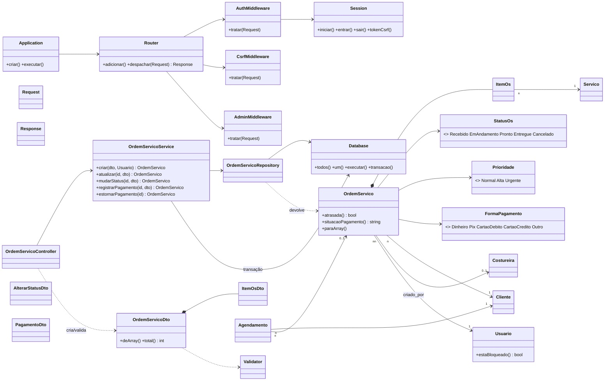

# Diagrama de classes (back-end PHP)

Orientação a objetos em camadas: **Controller → Service → Repository → Model**, com **DTO** na fronteira
de entrada (validação) e **Enums** tipados para os domínios fechados.

## Responsabilidade de cada camada

| Camada | Pasta | Faz | Não faz |
|---|---|---|---|
| Core | `app/Core` | Roteador, Request/Response, sessão, CSRF, PDO, validador | Regra de negócio |
| Middleware | `app/Middleware` | Exige sessão (401), perfil admin (403), CSRF (403) | Acessar banco além do usuário logado |
| Controller | `app/Controllers` | Recebe a requisição, monta o DTO, chama o service, devolve JSON | Regra de negócio, SQL |
| DTO | `app/Dto` | Valida e normaliza a entrada (422 por campo) | Acessar banco |
| Service | `app/Services` | Regras RN01–RN18, transações, orquestração | SQL, HTTP |
| Repository | `app/Repositories` | SQL com PDO e *prepared statements* | Regra de negócio |
| Model | `app/Models` | Entidade + comportamento derivado (atrasada, situação de pagamento) | Persistência |
| Enums | `app/Enums` | Domínios fechados e tipados | — |
