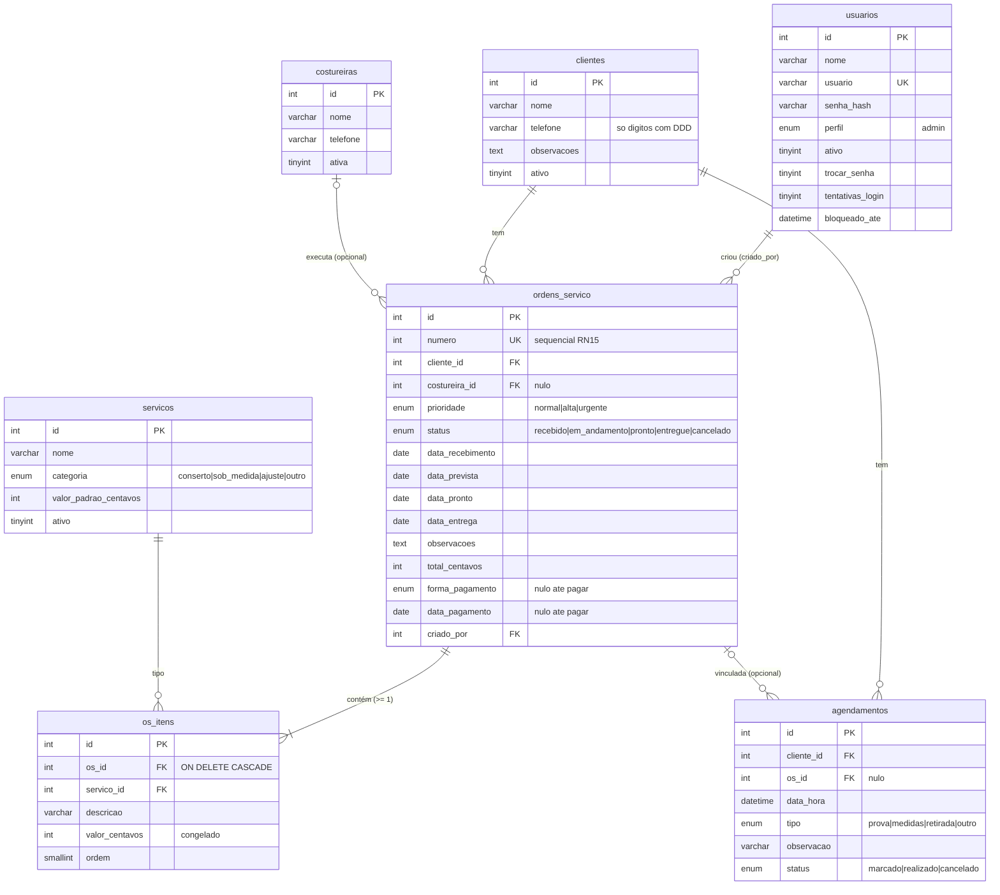

# Modelagem de dados

Banco MySQL/MariaDB, `utf8mb4`. Sete tabelas (a tabela `pagamentos` do desenho original foi eliminada
pela decisão fechada nº 1: pagamento único, gravado na própria OS). Dinheiro em **centavos inteiros**.

## Diagrama Entidade-Relacionamento

Todas as tabelas têm também `criado_em` e `atualizado_em`.

## Decisões de modelagem

| Tema | Decisão |
|---|---|
| Integridade | FKs com `ON DELETE RESTRICT` onde há histórico; `CASCADE` somente de `os_itens` para a OS. |
| Valores | `INT` em centavos (R$ 35,00 = 3500). Evita erro de arredondamento. |
| `status`, `prioridade`, `forma` | `ENUM` no banco **e** enums PHP (`app/Enums`), mantidos iguais. |
| Atrasada / situação do pagamento | **Derivadas**, nunca gravadas (RN07, RN11). |
| Pagamento | `forma_pagamento` + `data_pagamento` na OS; pago = `data_pagamento` preenchida. |
| Índices | `clientes.nome`, `clientes.telefone`, `ordens_servico.status`, `.data_prevista`, `.data_recebimento`, `.data_pagamento`, `.costureira_id`, `agendamentos.data_hora`. |
| Fuso | `America/Sao_Paulo` no PHP e `SET time_zone='-03:00'` no MySQL. |
